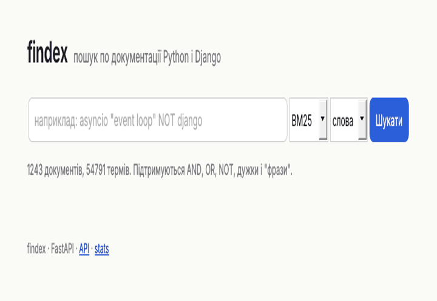
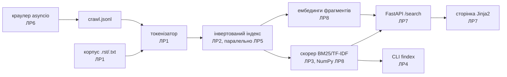
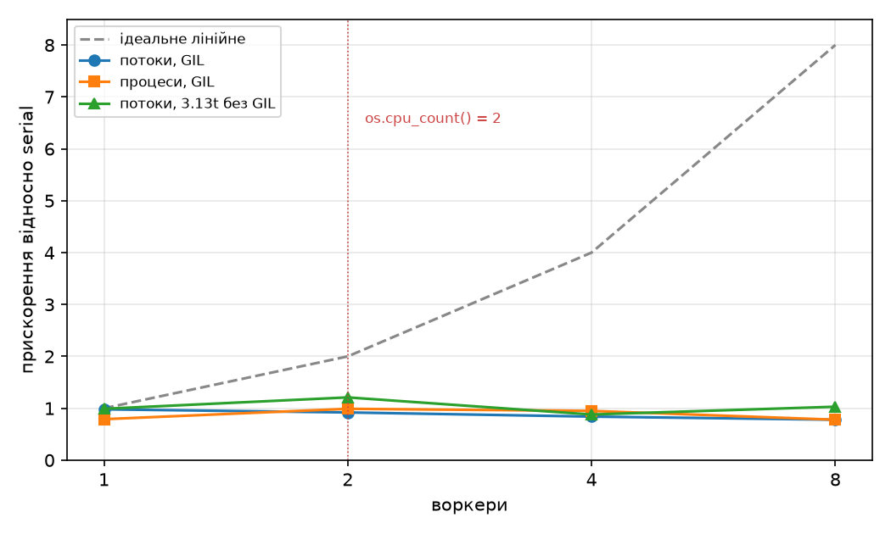

# findex

Повнотекстовий пошуковий рушій по документації CPython і Django: лінивий корпус, інвертований індекс, BM25, мова запитів, асинхронний краулер, FastAPI і гібридний семантичний пошук.

**Жива адреса:** `<вставте адресу після деплою на Render>` · **Відео (2–3 хв):** `<вставте посилання>` · 



| 1243 документи, 2,67 млн токенів | p95 локально (4 воркери): 3695 мс при 50 клієнтах | NumPy-скорер: до 14,1× |
|---|---|---|



## Швидкий старт

```
uv sync --extra semantic
uv run findex index data/ -o index.bin
uv run findex embed index.bin            # для режимів semantic і hybrid
uv run findex search index.bin '"event loop" NOT django' --mode hybrid
uv run findex serve --index index.bin    # http://127.0.0.1:8000
```

## Обмеження

- Семантична модель — WordLlama l2_supercat (статичні вектори токенів, 256 вимірів), а не all-MiniLM-L6-v2: оточення не мало доступу до huggingface.co. На перефразованих запитах вона програє BM25 (таблиця нижче).
- Корпус лише англійською; токенізатор без стемінгу («queries» і «query» — різні терми).
- Машина для вимірів мала 2 ядра, тому паралельні виміри ЛР5 не показують масштабування понад 2 воркери.
- oha недоступний в оточенні: навантажувальний тест — власний скрипт на httpx (`scripts/loadtest.py`).
- Індекс завантажується в пам'ять цілком (~300 MB RSS); memmap не реалізовано.

# Виміри за всі лаби

## Корпус

- `data/pydocs/` — `git clone --depth 1 --filter=blob:none --sparse https://github.com/python/cpython.git` + `git sparse-checkout set Doc` (коміт ef1fce0, 29.10.2026);
- `data/django/` — так само з `https://github.com/django/django.git`, `docs` (коміт 817df1c).

Лишаються лише .rst/.txt: 1243 документи, 23 МБ тексту, 2 670 986 токенів. `data/` у `.gitignore`.

## Лаба 1 — лінивий корпус

`python -m findex.stats data/ [--limit N] [--eager]`

Правила токенізатора: NFC → `casefold()` → `\w+(?:'\w+)*`; апострофи ’ ʼ зводяться до `'` і лишаються всередині слова; дефіс і крапка розривають токен; підкреслення лишається (ідентифікатори).

| Версія | Документи | Пікова пам'ять | Час |
|---|---|---|---|
| eager (lists) | 1243 | 163.2 MiB | 12.83 s |
| lazy (generators) | 1243 | 7.9 MiB | 12.31 s |

Жадібна версія тримає одночасно всі 1243 тексти (str) і 2,67 млн рядків-токенів у списках списків (кожен елемент — вказівник 8 байт плюс об'єкт str). Лінива версія тримає один документ, його токени по одному і `Counter` на 54 791 терм — це і є 7,9 MiB.

## Лаба 2 — інвертований індекс

```
python -m findex.index data/ --out index.bin [--positions] [--format pickle|binary]
python -m findex.search index.bin "asyncio event loop" [--engine merge|set]
```

`pickle.load` виконує код із файлу (через `__reduce__`), тому завантажується лише власний індекс; другий формат (binary: JSON-заголовок + буфери `array('I')`) коду не виконує.

Merge vs set, мкс на виклик (найкраще з 10 × 200):

| Пара термів | df | Операція | merge | set |
|---|---|---|---|---|
| the / in (найчастіші) | 1173 / 1197 | AND | 157.47 | 48.85 |
| the / in | 1173 / 1197 | OR | 161.03 | 49.96 |
| editability / zoomtext (найрідкісніші) | 1 / 1 | AND | 0.28 | 0.59 |
| editability / zoomtext | 1 / 1 | OR | 0.46 | 0.58 |

Збереження і завантаження (медіана з 3):

| Формат | Розмір, MiB | save, s | load, s |
|---|---|---|---|
| pickle | 9.13 | 2.79 | 3.11 |
| binary | 5.38 | 0.18 | 1.74 |
| pickle + positions | 17.18 | 3.42 | 4.02 |
| binary + positions | 17.63 | 0.74 | 2.15 |

Пам'ять трьох представлень постінгів (541 763 постінги):

| Представлення | Пік (build), MiB | Файл (pickle), MiB | load, s |
|---|---|---|---|
| `list[Posting]` plain `@dataclass` | 60.6 | 10.58 | 0.70 |
| `list[Posting]` `slots=True` | 40.1 | 8.51 | 1.58 |
| пари `array('I')` | 23.7 | 6.60 | 0.09 |

Звичайний екземпляр — 48 байт заголовка плюс окремий `__dict__` на 88 байт; зі slots словника немає. У масиві `array('I')` один постінг — 2 × 4 байти без об'єктів і без вказівників у списку. Повільніше завантаження slots-версії через pickle пояснюється тим, що dataclass зі slots відновлює стан через згенерований на Python `__setstate__`.

## Лаба 3 — рейтинг і модель об'єктів

`Index(Mapping)` підтримує `len`, `in`, `index[term]`, ітерацію і `repr`; `open_index(path)` — контекстний менеджер. TF-IDF і BM25(k1=1.5, b=0.75) задовольняють протокол `Scorer`. Парсер рекурсивного спуску будує дерево `Term/Phrase/And/Or/Not`.

Перевірки рейтингу на корпусі (`scripts/lab3_eval.py`):
1. idf(zoneinfo, df=12) = 4.600 проти idf(the, df=1173) = 0.058: документ про zoneinfo на першому місці.
2. Документ середньої довжини, терм asyncio: друге входження додає 1.190 бала, двадцяте — 0.0236.
3. tf = 1: документ на 85 токенів отримує 2.630, документ на 14 107 токенів — 0.426.

Сліди `@timed` і кешу:
```
findex.ranking: cache miss: evaluating 'python AND (async OR await) NOT java "event loop"'
findex.timing: search took 22.3 ms
findex.ranking: cache hit for 'python AND (async OR await) NOT java "event loop"'
findex.timing: search took 14.1 ms
```

Precision@5 (10 запитів, терми через OR): TF-IDF — 0.50, BM25 — 0.44.

## Лаба 4 — типи, тести, пакування, CLI


```
uv tool install .            # або: uv tool install dist/findex-0.4.0-py3-none-any.whl
findex index data/ -o index.bin
findex search index.bin '"event loop" (thread OR executor)' -k 3
findex search index.bin 'pickle untrusted' --json | jq .path
findex stats index.bin
```

pyright strict: 0 errors; ruff: clean; pytest: 48 тестів (4 властивості Hypothesis), покриття 80%.
Поза покриттям навмисно лишились `stats.py` і `main()` у `index.py`/`search.py` (старі точки входу ЛР1–2, замінені CLI) та гілка JSONL у `corpus.py` (корпус у форматі каталогу).

## Лаба 5 — конкурентність і GIL

`findex index data/ -o index.bin --workers N --executor {serial,threads,processes}`

Машина: Intel Xeon @ 2.80GHz, `os.cpu_count()` = 2, Linux 6.18, CPython 3.13.18 і 3.13.14t (free-threading).
Кожна клітинка — медіана з 3 запусків в окремому процесі після прогріву; індекс з позиціями.

| Виконавець | Воркери | Wall, s | CPU, s | Пік RSS, MB | Merge, s | Прискорення |
|---|---|---|---|---|---|---|
| serial | 1 | 5.18 | 5.06 | 245 | 1.18 | 1.00 |
| threads | 2 | 5.64 | 5.52 | 277 | 1.49 | 0.92 |
| threads | 4 | 6.16 | 6.01 | 295 | 1.48 | 0.84 |
| threads | 8 | 6.67 | 6.44 | 320 | 1.52 | 0.78 |
| processes | 2 | 5.23 | 7.07 | 295 | 1.94 | 0.99 |
| processes | 4 | 5.45 | 7.52 | 306 | 2.02 | 0.95 |
| processes | 8 | 6.63 | 8.57 | 324 | 1.94 | 0.78 |
| threads, 3.13t | 2 | 5.08 | 6.09 | 330 | 1.69 | 1.21 |
| threads, 3.13t | 4 | 7.00 | 7.21 | 347 | 1.72 | 0.88 |



Окремо map і merge (`scripts/lab5_map_merge.py`): serial — map 5.00 s, merge 1.55 s; processes ×2 — map 2.66 s, merge 1.87 s. Процеси прискорюють map у 1,9 раза, але merge лишається послідовним, тому загальний виграш упирається в закон Амдала. На двох ядрах ліміт для частки merge 24% — 1/(0.24 + 0.76/2) ≈ 1.6.

Гонитва на спільному dict (`scripts/lab5_race.py`, 4 потоки, 502 418 токенів): без замка під GIL втрачено 857–2348 оновлень, на 3.13t (`sys._is_gil_enabled() = False`) — 534–753; з `threading.Lock` і з локальним `Counter` на потік втрат немає. У `build_partial` спільного стану немає взагалі.

I/O-дослід (`scripts/lab5_io.py`, 50 URL, затримка сервера 50 мс): 1 потік — 2.60 s, 16 потоків — 0.23 s (11,4×).
Типовим лишається `--executor serial`: на цій машині процеси не дали стабільного виграшу в повному часі.

## Лаба 6 — асинхронний краулер

`findex crawl <seed> --max-pages 500 --concurrency 10 --per-host 2 [--min-delay 0.2] --out data/crawl.jsonl --log crawl.log`

Дозвіл: обходиться лише власне локальне дзеркало корпусу (`scripts/build_mirror.py` + `scripts/mirror_server.py`, затримка відповіді 50 мс), robots.txt дзеркала забороняє `/pydocs/whatsnew/`. User-Agent: `findex-crawler/0.6 (student project; +https://github.com/nazarpoptsov/findex)`. Стеля — `--max-pages`.

Seed `http://127.0.0.1:8765/index.html`, max_pages = 250:

| Concurrency | per_host | Сторінки | Wall, s | Сторінок/с | Помилки | Пік RSS, MB |
|---|---|---|---|---|---|---|
| 1 | 1 | 250 | 13.57 | 18.4 | 0 | 46 |
| 5 | 5 | 250 | 3.02 | 82.7 | 0 | 47 |
| 20 | 20 | 250 | 1.07 | 234.5 | 0 | 47 |
| 20 | 2 | 250 | 7.17 | 34.9 | 0 | 47 |

Збій 429 (сервер повертає 429 з `Retry-After: 1` кожному 7-му запиту), лог:
```
INFO findex.crawler.fetch: retry http://127.0.0.1:8766/django/README.html in 1.00s (attempt 1, status 429, Retry-After)
03:16:33 200 1131 1.109s attempts=2  http://127.0.0.1:8766/django/README.html
```
Запуск із `--debug` (`asyncio.run(..., debug=True)`) не дав жодного попередження про блокування циклу подій.
Повний обхід: 1048 сторінок → `findex index crawl.jsonl` → 43 029 термів.

## Лаба 7 — FastAPI і публічна адреса

**Публічна адреса:** `<вставте адресу після деплою на Render>`

```
findex serve --index index.bin --port 8000 [--workers 4]
docker build -t findex . && docker run -e INDEX_PATH=/app/deploy/index.bin -p 8000:8000 findex
```

Маршрути: `GET /search?q=&k=&scorer=&page=`, `GET /docs/{doc_id}`, `GET /stats`, `GET /health` (503, поки індекс не завантажено), `GET /` (сторінка), `GET /doc/{id}`. OpenAPI — `/docs`.

20 одночасних запитів `/search` (1 воркер, `scripts/lab7_concurrent20.py`):

| Варіант | Останній пошук, мс | `/health` під навантаженням, мс |
|---|---|---|
| `async def` | 814–881 | 748–821 |
| `def` | 1023–1062 | 145–634 |

У `async def` CPU-робота йде прямо в циклі подій, тому навіть `/health` чекає, поки відпрацюють усі пошуки. У `def` пошук іде в пул потоків, цикл подій вільний, і `/health` відповідає раніше. Сумарний час для `def` трохи більший (через GIL потоки по черзі виконують той самий CPU-код плюс накладні витрати пулу), але сервіс лишається чутливим, тому в коді лишився `def`.

Навантаження (50 клієнтів, 20 с, `scripts/loadtest.py`; oha в оточенні недоступний):

| Ціль | Конкурентність | RPS | p50, мс | p95, мс | p99, мс |
|---|---|---|---|---|---|
| локально, 1 воркер, `async def` | 50 | 22.3 | 2200.0 | 2553.9 | 2599.0 |
| локально, 1 воркер, `def` | 50 | 18.6 | 2682.8 | 3501.4 | 3660.0 |
| локально, 4 воркери, `def` | 50 | 32.8 | 513.1 | 3695.0 | 3993.7 |
| розгорнутий сервіс | 20 | `<вставте>` | `<вставте>` | `<вставте>` | `<вставте>` |

## Лаба 8 — профілювання, NumPy, семантичний пошук

Профілі: `docs/flame_search.svg`, `docs/flame_index.svg` (py-spy), cProfile і Scalene — `scripts/lab8_profile.py`.

Три гарячі місця до змін:
1. `store.load` — 1.06 s власного часу з 3.19 s (cProfile): відновлення 541 тис. об'єктів `Posting` з масивів. Час у Python.
2. `BM25.score` + `idf` + `df` — 504 400 викликів на 200 запитів: idf перераховується для кожного постінга. Час у Python (виклики функцій).
3. `build_index` + `tokenize` — 2.59 s і 1.49 s з 6.64 s: цикл по токенах і `list.append` позицій. Час у Python; `str.translate` (0.75 s) — нативний.

| Запит | Документів | Скорер ЛР3, мс | NumPy, мс | Прискорення |
|---|---|---|---|---|
| частий терм `the` | 1173 | 0.961 | 0.092 | 10.4× |
| рідкісний терм `genindex` | 3 | 0.006 | 0.030 | 0.2× |
| середній терм `coroutine` | 59 | 0.061 | 0.049 | 1.3× |
| 3 терми `the OR python OR function` | 1182 | 1.974 | 0.140 | 14.1× |

Порядок результатів збігається з ЛР3 (тест `tests/test_fast.py`; на корпусі — 2000 найчастіших термів, 0 розбіжностей). На рідкісному термі NumPy програє: три постінги рахуються швидше, ніж створюються масиви й викликаються `np.add.at` та `argpartition`.

Precision@5 (BM25 через OR / семантичний / гібрид RRF, k = 60):

| Група | keyword | semantic | hybrid |
|---|---|---|---|
| 10 запитів ЛР3 | 0.44 | 0.38 | 0.44 |
| 5 перефразованих | 0.16 | 0.08 | 0.12 |

Статична модель WordLlama усереднює вектори токенів і не розуміє порядку слів, тому на перефразованих запитах вона не перевершила BM25. Гібрид ніде не опустився нижче семантичного режиму і на «database transaction atomic» та «remember results of expensive calls» дав більше, ніж кожен режим окремо.
